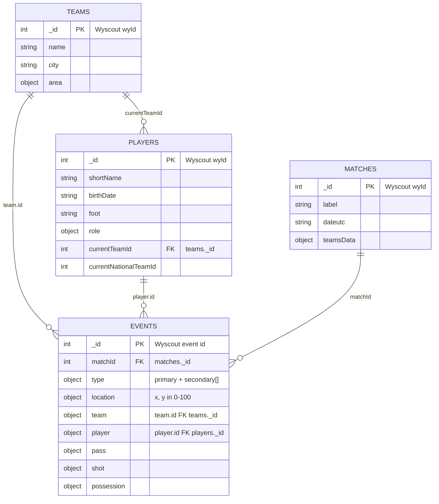

# Wyscout x MongoDB: CRUD & Football Analytics


Master's project for the course "Baze de date NoSQL" (ASE Bucharest): a MongoDB Atlas database built from real **Wyscout API v3** football data, with full CRUD, six Aggregation Framework pipelines and an application on top.

## Table of Contents

1. [Project Overview](#project-overview)
3. [The Database](#the-database)
4. [Create: ingest with validation](#create-ingest-with-validation)
5. [Read: find queries R1-R3](#read-find-queries-r1-r3)
6. [Update: editHistory and bulk operators](#update-edithistory-and-bulk-operators)
7. [Delete: impact and cascade](#delete-impact-and-cascade)
8. [Aggregation Framework A1-A6](#aggregation-framework-a1-a6)
9. [Seminar operator coverage](#seminar-operator-coverage)
11. [Application and code map](#application-and-code-map)
12. [Setup & Run](#setup--run)

---

## Project Overview

|                  |                                                                                                                                         |
| ---------------- | --------------------------------------------------------------------------------------------------------------------------------------- |
| **Data**         | Fake Wyscout-API-v3-shaped JSON from `scripts/make_fake_data.py` (invented teams and players) |
| **Matches**      | Aurora FC - Borealis United 2-1, Cascadia Rovers - Aurora FC 1-1 |
| **Volume**       | 2 matches, 3 teams, 60 players, 832 events |
| **Database**     | `wyscout_nosql` on MongoDB Atlas, 4 collections                                                                                         |
| **CRUD**         | Create (ingest + validation), Read (3 find queries), Update (field edits with audit trail, 7 bulk operators), Delete (impact + cascade) |
| **Aggregations** | 6 pipelines answering match-analysis questions, each shown in the seminar's chained mongosh syntax and in Python                        |
| **Application**  | Streamlit UI -> FastAPI -> MongoDB Atlas                                                                                                |

The real Wyscout files are licensed and **not included** in the repository. `scripts/make_fake_data.py` generates realistic fake files with the same structure into `data/fake/`, and every example below uses that fake data.

---

## The Database

### Collections

| Collection | `_id`              | Documents | What one document is                     | Secondary indexes                                                    |
| ---------- | ------------------ | --------- | ---------------------------------------- | -------------------------------------------------------------------- |
| `teams`    | Wyscout `wyId`     | 16        | a club                                   | `name`                                                               |
| `players`  | Wyscout `wyId`     | ~500      | a player profile                         | `currentTeamId`, `shortName`                                         |
| `matches`  | Wyscout `wyId`     | 3         | a match with score per team              | `date`                                                               |
| `events`   | Wyscout event `id` | 4,762     | one on-ball action (pass, shot, duel...) | `matchId`, `type.primary`, `player.id`, `team.id`, `opponentTeam.id` |

- The Wyscout id is reused as `_id`, so a duplicate upload is caught by MongoDB itself and lookups need no extra key.
- The database, the collections and the indexes are created by `create_indexes()` when the API starts ([db.py](backend/db.py)). `create_index` is idempotent, so restarting is safe.

### References between collections



`events.player.id -> players._id`, `events.team.id -> teams._id`, `events.matchId -> matches._id`, `players.currentTeamId -> teams._id`

### Sample documents (trimmed)

**events**: coordinates are 0-100 and always seen from the acting team, which attacks left to right.

```json
{ "_id": 1500100001, "id": 1500100001, "matchId": 5900001, "matchPeriod": "1H", "minute": 0, "second": 1, "type": { "primary": "pass", "secondary": ["back_pass"] }, "location": { "x": 22, "y": 90 }, "team": { "id": 61001, "name": "Aurora FC", "formation": "4-4-2" }, "opponentTeam": { "id": 61002, "name": "Borealis United", "formation": "4-4-2" }, "player": { "id": 300012, "name": "W. Drilovan", "position": "amf" }, "pass": { "accurate": true, "length": 22.5, "endLocation": { "x": 13, "y": 60 } }, "shot": null, "possession": { "id": 5900001001, "types": ["attack"], "team": { "name": "Aurora FC" }, "attack": null } }
```

**players**: `editHistory`, `tags`, `marketValueEUR` and `verifiedAt` are added by the application.

```json
{ "_id": 300000, "wyId": 300000, "shortName": "L. Ostath", "firstName": "Lysan", "lastName": "Ostath", "birthDate": "2006-10-18", "foot": "right", "height": 189, "role": { "name": "Goalkeeper", "code2": "GK", "code3": "GKP" }, "currentTeamId": 61001, "currentNationalTeamId": null, "editHistory": [{ "field": "height", "old": 188, "new": 189, "at": "2026-11-19T10:00:00Z" }] }
```

**teams**

```json
{ "_id": 61001, "wyId": 61001, "name": "Aurora FC", "officialName": "Aurora Football Club", "city": "Valmora", "area": { "name": "Romania" }, "type": "club", "category": "default" }
```

**matches**

```json
{ "_id": 5900001, "wyId": 5900001, "label": "Aurora FC - Borealis United, 2-1", "dateutc": "2026-11-08 16:00:00", "seasonId": 199001, "teamsData": { "61001": { "teamId": 61001, "side": "home", "score": 2 }, "61002": { "teamId": 61002, "side": "away", "score": 1 } } }
```

---

## Create: ingest with validation

> **Task description:** load Wyscout JSON files into the four collections. Every upload is validated first (**dry run**, nothing is written), then inserted. Insert runs the same checks again, so the counts of a dry run and of the real insert always agree.

Endpoint: `POST /ingest/{entity}?dry_run=true|false` &nbsp;|&nbsp; Source code: [ingest_controller.py](backend/controllers/ingest_controller.py)

**Validation rules**

| Collection     | Rule                                                                                                            | Result                                                     |
| -------------- | --------------------------------------------------------------------------------------------------------------- | ---------------------------------------------------------- |
| all            | file must be valid JSON: a list, one object, or a wrapper like `{"events": [...]}`                              | file rejected                                              |
| all            | required keys: teams `wyId, name`; players `wyId, shortName`; matches `wyId, label`; events `id, matchId, type` | record rejected (catches a file dropped in the wrong zone) |
| teams, players | id already stored, or repeated in the upload                                                                    | **skipped**                                                |
| players        | `currentTeamId` not in `teams`                                                                                  | warning                                                    |
| matches        | `wyId` already stored                                                                                           | **rejected**                                               |
| events         | the match already has events stored, or the upload repeats an event id                                          | **the whole match is rejected** (never half a match twice) |
| events         | the match is not in `matches`                                                                                   | warning                                                    |

**MongoDB commands behind it**

```js
// is anything already stored?
db.players.find({_id: {$in: [300000, 300001, ...]}}, {_id: 1})
db.events.distinct("matchId", {matchId: {$in: [5900001, 5900002]}})

// insert, only when dry_run = false (_id = Wyscout id, imageDataURL removed)
db.events.insertMany([...], {ordered: false})
```

`ordered: false` lets MongoDB continue after a single failing document instead of stopping the whole batch.

<details>
<summary>Expected Results:</summary>

Four upload zones (teams, players, matches, events). _Validate_ shows accepted / skipped / rejected counts per collection with the errors and warnings. _Insert_ is enabled only after validating the same files, inserts in the order teams -> players -> matches -> events, shows a confirmation and clears the upload zones. Uploading the same events again rejects the whole match.

<!-- screenshot: ingest page with the validation report -->
</details>

---

## Read: find queries R1-R3

> **Task description:** three `find()` queries with filters, projection, sort and limit. The mongosh and Python text shown in the app is generated from the same Python query that runs ([mongosh_text.py](backend/services/mongosh_text.py)), so they can never differ.

Endpoint: `POST /analytics/{R1|R2|R3}` &nbsp;|&nbsp; Source code: [find_controller.py](backend/controllers/find_controller.py) &nbsp;|&nbsp; Shown below for match `5900001` with the default parameters.

### R1. Which big chances were missed late in the game?

Shots with xG above 0.25, from minute 75, that did not end in a goal. Sorted by xG, top 20. "All matches" removes the `matchId` condition.

```js
db.events
  .find({
    matchId: 5900001,
    "type.primary": "shot",
    "shot.xg": { $gt: 0.25 },
    "shot.isGoal": false,
    minute: { $gte: 75 },
  })
  .projection({
    _id: 0,
    matchId: 1,
    minute: 1,
    "player.name": 1,
    "team.name": 1,
    "shot.xg": 1,
    "shot.onTarget": 1,
    location: 1,
  })
  .sort({ "shot.xg": -1 })
  .limit(20);
```

<details>
<summary>Python (PyMongo)</summary>

```python
query = {
    "matchId": 5900001,
    "type.primary": "shot",
    "shot.xg": {"$gt": 0.25},
    "shot.isGoal": False,
    "minute": {"$gte": 75}
}
projection = {
    "_id": 0,
    "matchId": 1,
    "minute": 1,
    "player.name": 1,
    "team.name": 1,
    "shot.xg": 1,
    "shot.onTarget": 1,
    "location": 1
}
rows = list(
    db.events.find(query, projection)
    .sort([("shot.xg", -1)])
    .limit(20)
)
```

</details>

**On the fake data:** two shots across the two matches, both at minute 79 with xG 0.47 (H. Zanino and P. Beluro, Aurora FC). Shown on a shot map (marker size = xG).

### R2. Scouting shortlist: left-footed outfield players, born 2003 or later, already with a national team

Shows `$ne`, `$gte` on a `"YYYY-MM-DD"` string (it sorts like a date), an optional case-insensitive `$regex`, and `$exists` + `$ne: null`.

```js
db.players
  .find({
    foot: "left",
    "role.code2": { $ne: "GK" },
    birthDate: { $gte: "2003-01-01" },
    currentNationalTeamId: { $exists: true, $ne: null },
  })
  .projection({
    _id: 0,
    shortName: 1,
    birthDate: 1,
    "role.name": 1,
    foot: 1,
    height: 1,
    currentTeamId: 1,
    currentNationalTeamId: 1,
  })
  .sort({ birthDate: -1, shortName: 1 });
```

<details>
<summary>Python (PyMongo)</summary>

```python
query = {
    "foot": "left",
    "role.code2": {"$ne": "GK"},
    "birthDate": {"$gte": "2003-01-01"},
    "currentNationalTeamId": {"$exists": True, "$ne": None}
}
projection = {
    "_id": 0,
    "shortName": 1,
    "birthDate": 1,
    "role.name": 1,
    "foot": 1,
    "height": 1,
    "currentTeamId": 1,
    "currentNationalTeamId": 1
}
rows = list(
    db.players.find(query, projection)
    .sort([("birthDate", -1), ("shortName", 1)])
)
```

</details>

**On the fake data:** 10 players, youngest first (R. Ostino, born 2006).

### R3. How does each team defend its own box?

Clearances, interceptions and defensive duels inside the own penalty area (`x` 0-16, `y` 19-81). Shows `$and`, `$or`, `$in`, and an exact match on an array element (`"type.secondary": "defensive_duel"`).

```js
db.events
  .find({
    matchId: 5900001,
    $and: [{ "location.x": { $gte: 0, $lte: 16 } }, { "location.y": { $gt: 19, $lt: 81 } }],
    $or: [{ "type.primary": { $in: ["clearance", "interception"] } }, { "type.primary": "duel", "type.secondary": "defensive_duel" }],
  })
  .projection({
    _id: 0,
    minute: 1,
    "team.name": 1,
    "player.name": 1,
    "type.primary": 1,
    location: 1,
  })
  .sort({ minute: 1 });
```

<details>
<summary>Python (PyMongo)</summary>

```python
query = {
    "matchId": 5900001,
    "$and": [
        {"location.x": {"$gte": 0, "$lte": 16}},
        {"location.y": {"$gt": 19, "$lt": 81}}
    ],
    "$or": [
        {"type.primary": {"$in": ["clearance", "interception"]}},
        {"type.primary": "duel", "type.secondary": "defensive_duel"}
    ]
}
projection = {
    "_id": 0,
    "minute": 1,
    "team.name": 1,
    "player.name": 1,
    "type.primary": 1,
    "location": 1
}
rows = list(
    db.events.find(query, projection)
    .sort([("minute", 1)])
)
```

</details>

**Output:** the defensive actions inside each team's own box, drawn on one zoomed pitch per team (colour and marker per action type).

---

## Update: editHistory and bulk operators

> **Task description:** edit players or teams field by field. Only real differences are written, emptied fields are removed, and every change is logged inside the document itself. Bulk operations apply the seminar update operators to all players of a team.

Endpoints: `PATCH /players`, `PATCH /teams`, `POST /players/bulk` &nbsp;|&nbsp; Source code: [edit_history.py](backend/services/edit_history.py), [players_controller.py](backend/controllers/players_controller.py)

**Single document: one `updateOne` with three operators**

1. The stored document is flattened to `{"role.name": "Forward", "height": 178, ...}` (lists and `_id`, `wyId`, `editHistory` are not editable).
2. The new values are compared with the stored ones; only real differences are kept.
3. One update is sent: `$set` for changed fields, `$unset` for emptied fields, `$push` + `$each` to append one entry per change to `editHistory`.

```js
db.players.updateOne(
  { _id: 300000 },
  {
    $set: { height: 178 },
    $unset: { middleName: "" },
    $push: {
      editHistory: {
        $each: [
          {
            field: "height",
            old: 177,
            new: 178,
            at: new Date("2026-11-19T10:00:00+00:00"),
          },
          {
            field: "middleName",
            old: "Ion",
            new: null,
            at: new Date("2026-11-19T10:00:00+00:00"),
          },
        ],
      },
    },
  },
);
```

**Bulk: `updateMany` on all players of a team**

| Operation        | MongoDB update                                                                                               |
| ---------------- | ------------------------------------------------------------------------------------------------------------ |
| `set_verified`   | `db.players.updateMany({currentTeamId: 11564}, {$set: {verifiedAt: new Date("2026-11-19T10:00:00+00:00")}})` |
| `unset_verified` | `db.players.updateMany({currentTeamId: 11564}, {$unset: {verifiedAt: ""}})`                                  |
| `set_value`      | `db.players.updateMany({currentTeamId: 11564}, {$set: {marketValueEUR: 1000000}})`                           |
| `mul_value`      | `db.players.updateMany({currentTeamId: 11564}, {$mul: {marketValueEUR: 1.1}})`                               |
| `push_tag`       | `db.players.updateMany({currentTeamId: 11564}, {$push: {tags: "shortlist"}})`                                |
| `push_tags`      | `db.players.updateMany({currentTeamId: 11564}, {$push: {tags: {$each: ["u21", "scouted"]}}})`                |
| `pull_tag`       | `db.players.updateMany({currentTeamId: 11564}, {$pull: {tags: "shortlist"}})`                                |

The result shows `matched_count` (players of the team) and `modified_count` (players that actually changed).

<details>
<summary>Expected Results:</summary>

Tick players or teams in the table, edit the pre-filled form, _Save changes_. The page confirms which documents were saved (by name), clears the ticks, and shows per document the diff, the exact `updateOne` that ran and the latest `editHistory` entries. The _Bulk operations_ expander shows the counts and the `updateMany` command.

<!-- screenshot: update page with a diff and editHistory -->
</details>

---

## Delete: impact and cascade

> **Task description:** before deleting, show what references the document. Deleting a team can also delete its players. Events are never deleted: they are the match history.

Endpoints: `GET /players/{id}/impact`, `DELETE /players/{id}`, `GET /teams/{id}/impact`, `DELETE /teams/{id}?cascade_players=true|false` &nbsp;|&nbsp; Source code: [players_controller.py](backend/controllers/players_controller.py), [teams_controller.py](backend/controllers/teams_controller.py)

```js
// impact
db.events.countDocuments({ "player.id": 300000 });
db.players.countDocuments({ currentTeamId: 11564 });
db.events.countDocuments({ "team.id": 11564 });

// delete a player
db.players.deleteOne({ _id: 300000 });

// delete a team, with cascade
db.teams.deleteOne({ _id: 11564 });
db.players.deleteMany({ currentTeamId: 11564 });
```

<details>
<summary>Expected Results:</summary>

Tick rows, read the impact table, optionally tick "also delete this team's players", confirm, press _Delete_. The result shows what was deleted and what was kept, with the commands that ran.

<!-- screenshot: delete page with impact and cascade -->
</details>

---

## Aggregation Framework A1-A6

> **Task description:** six multi-stage pipelines, each answering one match-analysis question. Every pipeline is written literally in Python and displayed in the seminar's chained syntax (`db.events.aggregate().match(...).group(...)`).

Endpoint: `POST /analytics/{A1..A6}` &nbsp;|&nbsp; Source code: [aggregate_controller.py](backend/controllers/aggregate_controller.py) &nbsp;|&nbsp; Shown below for match `5900001` with the default parameters.

### A1. Where does each team create danger?

**Pipeline logic**

1. `$match` shots and key passes of the match (`$or`, with an array-element match on `type.secondary`).
2. `$addFields` puts every action in a 3x3 pitch grid: `third` (DEF / MID / ATT along `x`) and `lane` (LEFT / CENTER / RIGHT along `y`) with `$switch`.
3. `$group` by team + zone: number of actions and total xG (`$ifNull` turns a missing xG into 0).
4. `$match` drops zones under the threshold; `$project` builds the zone name with `$concat`, rounds xG with `$round` and shows `$toUpper`.

```js
db.events
  .aggregate()
  .match({
    matchId: 5900001,
    $or: [{ "type.primary": "shot" }, { "type.secondary": "key_pass" }],
  })
  .addFields({
    third: {
      $switch: {
        branches: [
          { case: { $lt: ["$location.x", 33] }, then: "DEF" },
          {
            case: {
              $and: [{ $gte: ["$location.x", 33] }, { $lt: ["$location.x", 66] }],
            },
            then: "MID",
          },
        ],
        default: "ATT",
      },
    },
    lane: {
      $switch: {
        branches: [
          { case: { $lt: ["$location.y", 33] }, then: "LEFT" },
          { case: { $lt: ["$location.y", 66] }, then: "CENTER" },
        ],
        default: "RIGHT",
      },
    },
  })
  .group({
    _id: { team: "$team.name", third: "$third", lane: "$lane" },
    actions: { $sum: 1 },
    xg: { $sum: { $ifNull: ["$shot.xg", 0] } },
  })
  .match({ actions: { $gte: 1 } })
  .project({
    _id: 0,
    team: "$_id.team",
    teamCode: { $toUpper: "$_id.team" },
    zone: { $concat: ["$_id.third", "-", "$_id.lane"] },
    third: "$_id.third",
    lane: "$_id.lane",
    actions: 1,
    xg: { $round: ["$xg", 2] },
  })
  .sort({ team: 1, xg: -1 });
```

<details>
<summary>Python (PyMongo)</summary>

```python
pipeline = [
    {
        "$match": {
            "matchId": 5900001,
            "$or": [{"type.primary": "shot"}, {"type.secondary": "key_pass"}]
        }
    },
    {
        "$addFields": {
            "third": {
                "$switch": {
                    "branches": [
                        {"case": {"$lt": ["$location.x", 33]}, "then": "DEF"},
                        {
                            "case": {
                                "$and": [
                                    {"$gte": ["$location.x", 33]},
                                    {"$lt": ["$location.x", 66]}
                                ]
                            },
                            "then": "MID"
                        }
                    ],
                    "default": "ATT"
                }
            },
            "lane": {
                "$switch": {
                    "branches": [
                        {"case": {"$lt": ["$location.y", 33]}, "then": "LEFT"},
                        {
                            "case": {"$lt": ["$location.y", 66]},
                            "then": "CENTER"
                        }
                    ],
                    "default": "RIGHT"
                }
            }
        }
    },
    {
        "$group": {
            "_id": {"team": "$team.name", "third": "$third", "lane": "$lane"},
            "actions": {"$sum": 1},
            "xg": {"$sum": {"$ifNull": ["$shot.xg", 0]}}
        }
    },
    {"$match": {"actions": {"$gte": 1}}},
    {
        "$project": {
            "_id": 0,
            "team": "$_id.team",
            "teamCode": {"$toUpper": "$_id.team"},
            "zone": {"$concat": ["$_id.third", "-", "$_id.lane"]},
            "third": "$_id.third",
            "lane": "$_id.lane",
            "actions": 1,
            "xg": {"$round": ["$xg", 2]}
        }
    },
    {"$sort": {"team": 1, "xg": -1}}
]
rows = list(db.events.aggregate(pipeline))
```

</details>

**Output:** the number of dangerous actions and the xG per zone of the final third, for each team. Shown as one 3x3 heatmap per team.

### A2. In which 15-minute phases did each team control the match, and did control turn into threat?

**Pipeline logic**

1. `$match` the match; `$addFields` computes the phase `0..5` with `$floor($divide(minute, 15))`, capped by `$min` so stoppage time joins "75-90+".
2. A second `$addFields` builds the label (`"15-30"`) with `$concat` + `$toString`, using `$cond` for the last phase.
3. `$group` by team + phase: events, passes and accurate passes (`$sum` of `$cond`), final-third entries (pass that starts before `x = 66` and ends after it), xG, average pass length (`$avg`).
4. `$project` computes pass accuracy (guarded with `$cond` against division by 0) and rounds everything.
5. **`baseline_pipeline`**: same `$match`, one `$group` with `_id: null` for the whole match, divided by the number of (team, phase) cells counted with `$addToSet` + `$size`. It becomes the "Match average" row.

```js
db.events
  .aggregate()
  .match({ matchId: 5900001 })
  .addFields({
    phase: { $toInt: { $min: [{ $floor: { $divide: ["$minute", 15] } }, 5] } },
  })
  .addFields({
    phaseLabel: {
      $cond: [
        { $eq: ["$phase", 5] },
        "75-90+",
        {
          $concat: [{ $toString: { $multiply: ["$phase", 15] } }, "-", { $toString: { $multiply: [{ $add: ["$phase", 1] }, 15] } }],
        },
      ],
    },
  })
  .group({
    _id: { team: "$team.name", phase: "$phase", label: "$phaseLabel" },
    events: { $sum: 1 },
    passes: { $sum: { $cond: [{ $eq: ["$type.primary", "pass"] }, 1, 0] } },
    accurate: { $sum: { $cond: [{ $eq: ["$pass.accurate", true] }, 1, 0] } },
    finalThirdEntries: {
      $sum: {
        $cond: [
          {
            $and: [{ $eq: ["$type.primary", "pass"] }, { $lt: ["$location.x", 66] }, { $gte: ["$pass.endLocation.x", 66] }],
          },
          1,
          0,
        ],
      },
    },
    xg: { $sum: { $ifNull: ["$shot.xg", 0] } },
    avgPassLength: { $avg: "$pass.length" },
  })
  .project({
    _id: 0,
    team: "$_id.team",
    phase: "$_id.phase",
    phaseLabel: "$_id.label",
    events: 1,
    passes: 1,
    passAccuracy: {
      $cond: [{ $gt: ["$passes", 0] }, { $round: [{ $multiply: [{ $divide: ["$accurate", "$passes"] }, 100] }, 1] }, 0],
    },
    finalThirdEntries: 1,
    xg: { $round: ["$xg", 2] },
    avgPassLength: { $round: [{ $ifNull: ["$avgPassLength", 0] }, 1] },
  })
  .sort({ team: 1, phase: 1 });

// baseline_pipeline
db.events
  .aggregate()
  .match({ matchId: 5900001 })
  .addFields({
    phase: { $toInt: { $min: [{ $floor: { $divide: ["$minute", 15] } }, 5] } },
  })
  .group({
    _id: null,
    cells: { $addToSet: { team: "$team.name", phase: "$phase" } },
    events: { $sum: 1 },
    passes: { $sum: { $cond: [{ $eq: ["$type.primary", "pass"] }, 1, 0] } },
    accurate: { $sum: { $cond: [{ $eq: ["$pass.accurate", true] }, 1, 0] } },
    finalThirdEntries: {
      $sum: {
        $cond: [
          {
            $and: [{ $eq: ["$type.primary", "pass"] }, { $lt: ["$location.x", 66] }, { $gte: ["$pass.endLocation.x", 66] }],
          },
          1,
          0,
        ],
      },
    },
    xg: { $sum: { $ifNull: ["$shot.xg", 0] } },
    avgPassLength: { $avg: "$pass.length" },
  })
  .addFields({ cellCount: { $size: "$cells" } })
  .project({
    _id: 0,
    team: { $literal: "Match average" },
    events: { $round: [{ $divide: ["$events", "$cellCount"] }, 1] },
    passes: { $round: [{ $divide: ["$passes", "$cellCount"] }, 1] },
    passAccuracy: {
      $cond: [{ $gt: ["$passes", 0] }, { $round: [{ $multiply: [{ $divide: ["$accurate", "$passes"] }, 100] }, 1] }, 0],
    },
    finalThirdEntries: {
      $round: [{ $divide: ["$finalThirdEntries", "$cellCount"] }, 1],
    },
    xg: { $round: [{ $divide: ["$xg", "$cellCount"] }, 2] },
    avgPassLength: { $round: ["$avgPassLength", 1] },
  });
```

<details>
<summary>Python (PyMongo)</summary>

```python
pipeline = [
    {"$match": {"matchId": 5900001}},
    {
        "$addFields": {
            "phase": {
                "$toInt": {
                    "$min": [{"$floor": {"$divide": ["$minute", 15]}}, 5]
                }
            }
        }
    },
    {
        "$addFields": {
            "phaseLabel": {
                "$cond": [
                    {"$eq": ["$phase", 5]},
                    "75-90+",
                    {
                        "$concat": [
                            {"$toString": {"$multiply": ["$phase", 15]}},
                            "-",
                            {
                                "$toString": {
                                    "$multiply": [{"$add": ["$phase", 1]}, 15]
                                }
                            }
                        ]
                    }
                ]
            }
        }
    },
    {
        "$group": {
            "_id": {
                "team": "$team.name",
                "phase": "$phase",
                "label": "$phaseLabel"
            },
            "events": {"$sum": 1},
            "passes": {
                "$sum": {"$cond": [{"$eq": ["$type.primary", "pass"]}, 1, 0]}
            },
            "accurate": {
                "$sum": {"$cond": [{"$eq": ["$pass.accurate", True]}, 1, 0]}
            },
            "finalThirdEntries": {
                "$sum": {
                    "$cond": [
                        {
                            "$and": [
                                {"$eq": ["$type.primary", "pass"]},
                                {"$lt": ["$location.x", 66]},
                                {"$gte": ["$pass.endLocation.x", 66]}
                            ]
                        },
                        1,
                        0
                    ]
                }
            },
            "xg": {"$sum": {"$ifNull": ["$shot.xg", 0]}},
            "avgPassLength": {"$avg": "$pass.length"}
        }
    },
    {
        "$project": {
            "_id": 0,
            "team": "$_id.team",
            "phase": "$_id.phase",
            "phaseLabel": "$_id.label",
            "events": 1,
            "passes": 1,
            "passAccuracy": {
                "$cond": [
                    {"$gt": ["$passes", 0]},
                    {
                        "$round": [
                            {
                                "$multiply": [
                                    {"$divide": ["$accurate", "$passes"]},
                                    100
                                ]
                            },
                            1
                        ]
                    },
                    0
                ]
            },
            "finalThirdEntries": 1,
            "xg": {"$round": ["$xg", 2]},
            "avgPassLength": {
                "$round": [{"$ifNull": ["$avgPassLength", 0]}, 1]
            }
        }
    },
    {"$sort": {"team": 1, "phase": 1}}
]
rows = list(db.events.aggregate(pipeline))

# baseline_pipeline
baseline_pipeline = [
    {"$match": {"matchId": 5900001}},
    {
        "$addFields": {
            "phase": {
                "$toInt": {
                    "$min": [{"$floor": {"$divide": ["$minute", 15]}}, 5]
                }
            }
        }
    },
    {
        "$group": {
            "_id": None,
            "cells": {"$addToSet": {"team": "$team.name", "phase": "$phase"}},
            "events": {"$sum": 1},
            "passes": {
                "$sum": {"$cond": [{"$eq": ["$type.primary", "pass"]}, 1, 0]}
            },
            "accurate": {
                "$sum": {"$cond": [{"$eq": ["$pass.accurate", True]}, 1, 0]}
            },
            "finalThirdEntries": {
                "$sum": {
                    "$cond": [
                        {
                            "$and": [
                                {"$eq": ["$type.primary", "pass"]},
                                {"$lt": ["$location.x", 66]},
                                {"$gte": ["$pass.endLocation.x", 66]}
                            ]
                        },
                        1,
                        0
                    ]
                }
            },
            "xg": {"$sum": {"$ifNull": ["$shot.xg", 0]}},
            "avgPassLength": {"$avg": "$pass.length"}
        }
    },
    {"$addFields": {"cellCount": {"$size": "$cells"}}},
    {
        "$project": {
            "_id": 0,
            "team": {"$literal": "Match average"},
            "events": {"$round": [{"$divide": ["$events", "$cellCount"]}, 1]},
            "passes": {"$round": [{"$divide": ["$passes", "$cellCount"]}, 1]},
            "passAccuracy": {
                "$cond": [
                    {"$gt": ["$passes", 0]},
                    {
                        "$round": [
                            {
                                "$multiply": [
                                    {"$divide": ["$accurate", "$passes"]},
                                    100
                                ]
                            },
                            1
                        ]
                    },
                    0
                ]
            },
            "finalThirdEntries": {
                "$round": [
                    {"$divide": ["$finalThirdEntries", "$cellCount"]},
                    1
                ]
            },
            "xg": {"$round": [{"$divide": ["$xg", "$cellCount"]}, 2]},
            "avgPassLength": {"$round": ["$avgPassLength", 1]}
        }
    }
]
baseline = list(db.events.aggregate(baseline_pipeline))
```

</details>

**Output:** a heat-table per metric (rows = teams, columns = phases, red to green), with the match average as the last row.

### A3. Who actually moves the ball forward, and what's their profile?

**Pipeline logic**

1. `$match` passes that have an end location (`$exists`).
2. `$addFields` computes the forward gain (`$subtract` end x - start x) and flags progressive passes (`$cond` gain >= 15).
3. `$group` by player: passes, accurate passes, progressive passes, average gain.
4. `$match` keeps players with enough passes.
5. **`$lookup`** joins `events -> players` on `player.id = _id`; **`$unwind`** (with `preserveNullAndEmptyArrays`) turns the array into one profile object.
6. `$project` builds the full name with `$concat` (fallback `$ifNull`), the age with **`$dateDiff`** from `$toDate(birthDate)` to `$$NOW`, and the percentages with `$divide` + `$multiply` + `$round`.

```js
db.events
  .aggregate()
  .match({
    matchId: 5900001,
    "type.primary": "pass",
    "pass.endLocation": { $exists: true },
  })
  .addFields({ gain: { $subtract: ["$pass.endLocation.x", "$location.x"] } })
  .addFields({ progressive: { $cond: [{ $gte: ["$gain", 15] }, 1, 0] } })
  .group({
    _id: "$player.id",
    name: { $first: "$player.name" },
    team: { $first: "$team.name" },
    passes: { $sum: 1 },
    accurate: { $sum: { $cond: [{ $eq: ["$pass.accurate", true] }, 1, 0] } },
    progressive: { $sum: "$progressive" },
    avgGain: { $avg: "$gain" },
  })
  .match({ passes: { $gte: 15 } })
  .lookup({
    from: "players",
    localField: "_id",
    foreignField: "_id",
    as: "profile",
  })
  .unwind({ path: "$profile", preserveNullAndEmptyArrays: true })
  .project({
    _id: 0,
    playerId: "$_id",
    fullName: {
      $ifNull: [{ $concat: ["$profile.firstName", " ", "$profile.lastName"] }, "$name"],
    },
    team: 1,
    role: { $ifNull: ["$profile.role.name", "unknown"] },
    foot: "$profile.foot",
    age: {
      $dateDiff: {
        startDate: { $toDate: "$profile.birthDate" },
        endDate: "$$NOW",
        unit: "year",
      },
    },
    passes: 1,
    progressive: 1,
    accuracy: {
      $round: [{ $multiply: [{ $divide: ["$accurate", "$passes"] }, 100] }, 1],
    },
    progressiveShare: {
      $round: [{ $multiply: [{ $divide: ["$progressive", "$passes"] }, 100] }, 1],
    },
    avgGain: { $round: ["$avgGain", 1] },
  })
  .sort({ progressive: -1 });
```

<details>
<summary>Python (PyMongo)</summary>

```python
pipeline = [
    {
        "$match": {
            "matchId": 5900001,
            "type.primary": "pass",
            "pass.endLocation": {"$exists": True}
        }
    },
    {
        "$addFields": {
            "gain": {"$subtract": ["$pass.endLocation.x", "$location.x"]}
        }
    },
    {
        "$addFields": {
            "progressive": {"$cond": [{"$gte": ["$gain", 15]}, 1, 0]}
        }
    },
    {
        "$group": {
            "_id": "$player.id",
            "name": {"$first": "$player.name"},
            "team": {"$first": "$team.name"},
            "passes": {"$sum": 1},
            "accurate": {
                "$sum": {"$cond": [{"$eq": ["$pass.accurate", True]}, 1, 0]}
            },
            "progressive": {"$sum": "$progressive"},
            "avgGain": {"$avg": "$gain"}
        }
    },
    {"$match": {"passes": {"$gte": 15}}},
    {
        "$lookup": {
            "from": "players",
            "localField": "_id",
            "foreignField": "_id",
            "as": "profile"
        }
    },
    {"$unwind": {"path": "$profile", "preserveNullAndEmptyArrays": True}},
    {
        "$project": {
            "_id": 0,
            "playerId": "$_id",
            "fullName": {
                "$ifNull": [
                    {
                        "$concat": [
                            "$profile.firstName",
                            " ",
                            "$profile.lastName"
                        ]
                    },
                    "$name"
                ]
            },
            "team": 1,
            "role": {"$ifNull": ["$profile.role.name", "unknown"]},
            "foot": "$profile.foot",
            "age": {
                "$dateDiff": {
                    "startDate": {"$toDate": "$profile.birthDate"},
                    "endDate": "$$NOW",
                    "unit": "year"
                }
            },
            "passes": 1,
            "progressive": 1,
            "accuracy": {
                "$round": [
                    {
                        "$multiply": [
                            {"$divide": ["$accurate", "$passes"]},
                            100
                        ]
                    },
                    1
                ]
            },
            "progressiveShare": {
                "$round": [
                    {
                        "$multiply": [
                            {"$divide": ["$progressive", "$passes"]},
                            100
                        ]
                    },
                    1
                ]
            },
            "avgGain": {"$round": ["$avgGain", 1]}
        }
    },
    {"$sort": {"progressive": -1}}
]
rows = list(db.events.aggregate(pipeline))
```

</details>

**Output:** one row per player with passes, progressive passes, accuracy and average gain. Shown as a scatter (passes vs accuracy, size = average gain, colour = role).

### A4. How does each team build attacks, and how do they end?

**Pipeline logic**

1. `$match` events that belong to a possession.
2. `$group` #1 by `possession.id`: **one document per possession** with its team, its types, whether it ended with a shot (`$max` of `$cond`) and its xG.
3. **`$unwind`** the `types` array, so a possession tagged `["attack", "counterattack"]` counts in both types.
4. `$group` #2 by team + type: possessions (`$count`), possessions with a shot, total xG.
5. `$match` keeps frequent types; `$project` computes the shot rate and xG per possession.

If the data has no `possession` object, the API answers **422** with an explanation instead of failing.

```js
db.events
  .aggregate()
  .match({ matchId: 5900001, "possession.id": { $exists: true } })
  .group({
    _id: "$possession.id",
    team: { $first: "$possession.team.name" },
    types: { $first: "$possession.types" },
    withShot: {
      $max: { $cond: [{ $eq: ["$possession.attack.withShot", true] }, 1, 0] },
    },
    xg: { $max: { $ifNull: ["$possession.attack.xg", 0] } },
  })
  .unwind("$types")
  .group({
    _id: { team: "$team", type: "$types" },
    possessions: { $count: {} },
    withShot: { $sum: "$withShot" },
    xg: { $sum: "$xg" },
  })
  .match({ possessions: { $gte: 3 } })
  .project({
    _id: 0,
    team: "$_id.team",
    type: "$_id.type",
    possessions: 1,
    withShot: 1,
    shotRate: {
      $round: [{ $multiply: [{ $divide: ["$withShot", "$possessions"] }, 100] }, 1],
    },
    xg: { $round: ["$xg", 2] },
    xgPerPossession: { $round: [{ $divide: ["$xg", "$possessions"] }, 3] },
  })
  .sort({ team: 1, possessions: -1 });
```

<details>
<summary>Python (PyMongo)</summary>

```python
pipeline = [
    {"$match": {"matchId": 5900001, "possession.id": {"$exists": True}}},
    {
        "$group": {
            "_id": "$possession.id",
            "team": {"$first": "$possession.team.name"},
            "types": {"$first": "$possession.types"},
            "withShot": {
                "$max": {
                    "$cond": [
                        {"$eq": ["$possession.attack.withShot", True]},
                        1,
                        0
                    ]
                }
            },
            "xg": {"$max": {"$ifNull": ["$possession.attack.xg", 0]}}
        }
    },
    {"$unwind": "$types"},
    {
        "$group": {
            "_id": {"team": "$team", "type": "$types"},
            "possessions": {"$count": {}},
            "withShot": {"$sum": "$withShot"},
            "xg": {"$sum": "$xg"}
        }
    },
    {"$match": {"possessions": {"$gte": 3}}},
    {
        "$project": {
            "_id": 0,
            "team": "$_id.team",
            "type": "$_id.type",
            "possessions": 1,
            "withShot": 1,
            "shotRate": {
                "$round": [
                    {
                        "$multiply": [
                            {"$divide": ["$withShot", "$possessions"]},
                            100
                        ]
                    },
                    1
                ]
            },
            "xg": {"$round": ["$xg", 2]},
            "xgPerPossession": {
                "$round": [{"$divide": ["$xg", "$possessions"]}, 3]
            }
        }
    },
    {"$sort": {"team": 1, "possessions": -1}}
]
rows = list(db.events.aggregate(pipeline))
```

</details>

**Output:** for each team and possession type, the share of possessions that ended with a shot. Shown as a colour-graded table (possession type x team).

### A5. How intensely does each team press (PPDA), and where does it win the ball back?

**Pipeline logic**

1. `$match` the match; `$addFields` flags passes (`isPass`) and defensive actions (`isDefensive`: interceptions, fouls, clearances, and the defending half of a duel, with `$in` + `$or` + `$and`).
2. Second `$addFields`: **the pressing team**. A pass counts for its _opponent_ (the team that is pressing it, via `$cond`), a defensive action for its own team.
3. `$group` by pressing team: opponent passes in their own 60% of the pitch, defensive actions in the opponent's 60%, ball recoveries high up the pitch.
4. `$project` computes **PPDA = opponent passes / defensive actions** (`$max` avoids division by 0). Lower = more intense pressing.
5. **`zones_pipeline`**: defensive actions and recoveries per team per 3x3 zone (same `$switch` grid as A1), drawn as heatmaps.

```js
db.events
  .aggregate()
  .match({ matchId: 5900001 })
  .addFields({
    isPass: { $eq: ["$type.primary", "pass"] },
    isDefensive: {
      $or: [
        { $in: ["$type.primary", ["interception", "infraction", "clearance"]] },
        {
          $and: [{ $eq: ["$type.primary", "duel"] }, { $in: ["defensive_duel", { $ifNull: ["$type.secondary", []] }] }],
        },
      ],
    },
  })
  .addFields({
    pressTeam: { $cond: ["$isPass", "$opponentTeam.name", "$team.name"] },
  })
  .group({
    _id: "$pressTeam",
    oppPassesOwn60: {
      $sum: { $cond: [{ $and: ["$isPass", { $lte: ["$location.x", 60] }] }, 1, 0] },
    },
    defActionsHigh: {
      $sum: {
        $cond: [{ $and: ["$isDefensive", { $gte: ["$location.x", 40] }] }, 1, 0],
      },
    },
    highRecoveries: {
      $sum: {
        $cond: [
          {
            $and: [{ $in: ["recovery", { $ifNull: ["$type.secondary", []] }] }, { $gte: ["$location.x", 60] }],
          },
          1,
          0,
        ],
      },
    },
  })
  .match({ _id: { $ne: null } })
  .project({
    _id: 0,
    team: "$_id",
    ppda: {
      $round: [{ $divide: ["$oppPassesOwn60", { $max: ["$defActionsHigh", 1] }] }, 2],
    },
    oppPassesOwn60: 1,
    defActionsHigh: 1,
    highRecoveries: 1,
  })
  .sort({ ppda: 1 });

// zones_pipeline
db.events
  .aggregate()
  .match({
    matchId: 5900001,
    $or: [{ "type.primary": { $in: ["interception", "infraction", "clearance"] } }, { "type.primary": "duel", "type.secondary": "defensive_duel" }, { "type.secondary": "recovery" }],
  })
  .addFields({
    third: {
      $switch: {
        branches: [
          { case: { $lt: ["$location.x", 33] }, then: "DEF" },
          {
            case: {
              $and: [{ $gte: ["$location.x", 33] }, { $lt: ["$location.x", 66] }],
            },
            then: "MID",
          },
        ],
        default: "ATT",
      },
    },
    lane: {
      $switch: {
        branches: [
          { case: { $lt: ["$location.y", 33] }, then: "LEFT" },
          { case: { $lt: ["$location.y", 66] }, then: "CENTER" },
        ],
        default: "RIGHT",
      },
    },
  })
  .group({
    _id: { team: "$team.name", third: "$third", lane: "$lane" },
    defActions: { $sum: 1 },
    recoveries: {
      $sum: {
        $cond: [{ $in: ["recovery", { $ifNull: ["$type.secondary", []] }] }, 1, 0],
      },
    },
  })
  .project({
    _id: 0,
    team: "$_id.team",
    third: "$_id.third",
    lane: "$_id.lane",
    defActions: 1,
    recoveries: 1,
  })
  .sort({ team: 1, recoveries: -1 });
```

<details>
<summary>Python (PyMongo)</summary>

```python
pipeline = [
    {"$match": {"matchId": 5900001}},
    {
        "$addFields": {
            "isPass": {"$eq": ["$type.primary", "pass"]},
            "isDefensive": {
                "$or": [
                    {
                        "$in": [
                            "$type.primary",
                            ["interception", "infraction", "clearance"]
                        ]
                    },
                    {
                        "$and": [
                            {"$eq": ["$type.primary", "duel"]},
                            {
                                "$in": [
                                    "defensive_duel",
                                    {"$ifNull": ["$type.secondary", []]}
                                ]
                            }
                        ]
                    }
                ]
            }
        }
    },
    {
        "$addFields": {
            "pressTeam": {
                "$cond": ["$isPass", "$opponentTeam.name", "$team.name"]
            }
        }
    },
    {
        "$group": {
            "_id": "$pressTeam",
            "oppPassesOwn60": {
                "$sum": {
                    "$cond": [
                        {"$and": ["$isPass", {"$lte": ["$location.x", 60]}]},
                        1,
                        0
                    ]
                }
            },
            "defActionsHigh": {
                "$sum": {
                    "$cond": [
                        {
                            "$and": [
                                "$isDefensive",
                                {"$gte": ["$location.x", 40]}
                            ]
                        },
                        1,
                        0
                    ]
                }
            },
            "highRecoveries": {
                "$sum": {
                    "$cond": [
                        {
                            "$and": [
                                {
                                    "$in": [
                                        "recovery",
                                        {"$ifNull": ["$type.secondary", []]}
                                    ]
                                },
                                {"$gte": ["$location.x", 60]}
                            ]
                        },
                        1,
                        0
                    ]
                }
            }
        }
    },
    {"$match": {"_id": {"$ne": None}}},
    {
        "$project": {
            "_id": 0,
            "team": "$_id",
            "ppda": {
                "$round": [
                    {
                        "$divide": [
                            "$oppPassesOwn60",
                            {"$max": ["$defActionsHigh", 1]}
                        ]
                    },
                    2
                ]
            },
            "oppPassesOwn60": 1,
            "defActionsHigh": 1,
            "highRecoveries": 1
        }
    },
    {"$sort": {"ppda": 1}}
]
rows = list(db.events.aggregate(pipeline))

# zones_pipeline
zones_pipeline = [
    {
        "$match": {
            "matchId": 5900001,
            "$or": [
                {
                    "type.primary": {
                        "$in": ["interception", "infraction", "clearance"]
                    }
                },
                {"type.primary": "duel", "type.secondary": "defensive_duel"},
                {"type.secondary": "recovery"}
            ]
        }
    },
    {
        "$addFields": {
            "third": {
                "$switch": {
                    "branches": [
                        {"case": {"$lt": ["$location.x", 33]}, "then": "DEF"},
                        {
                            "case": {
                                "$and": [
                                    {"$gte": ["$location.x", 33]},
                                    {"$lt": ["$location.x", 66]}
                                ]
                            },
                            "then": "MID"
                        }
                    ],
                    "default": "ATT"
                }
            },
            "lane": {
                "$switch": {
                    "branches": [
                        {"case": {"$lt": ["$location.y", 33]}, "then": "LEFT"},
                        {
                            "case": {"$lt": ["$location.y", 66]},
                            "then": "CENTER"
                        }
                    ],
                    "default": "RIGHT"
                }
            }
        }
    },
    {
        "$group": {
            "_id": {"team": "$team.name", "third": "$third", "lane": "$lane"},
            "defActions": {"$sum": 1},
            "recoveries": {
                "$sum": {
                    "$cond": [
                        {
                            "$in": [
                                "recovery",
                                {"$ifNull": ["$type.secondary", []]}
                            ]
                        },
                        1,
                        0
                    ]
                }
            }
        }
    },
    {
        "$project": {
            "_id": 0,
            "team": "$_id.team",
            "third": "$_id.third",
            "lane": "$_id.lane",
            "defActions": 1,
            "recoveries": 1
        }
    },
    {"$sort": {"team": 1, "recoveries": -1}}
]
zones = list(db.events.aggregate(zones_pipeline))
```

</details>

**Output:** PPDA and high recoveries for each team. Shown as one card per team plus a recovery heatmap per team.

### A6. Does the squad actually use its young players?

**Pipeline logic** (starts from `teams`)

1. **Reverse `$lookup`** `teams -> players` on `currentTeamId`; `$addFields` stores the squad size (`$size`) and the list of names (`"$players.shortName"` reads one field from every array element).
2. `$unwind` the players; a second **`$lookup`** `players -> events` (projecting only `_id`) counts each player's events with `$size`.
3. `$addFields` computes the age (`$dateDiff`) and the age band with `$switch` (U21 / 21-29 / 30+).
4. `$group` #1 by team + band: players, names (`$push`), events, average age.
5. `$group` #2 by team: the team total, so every band becomes a **share of the team's events**; `$match` keeps the teams that played; `$unwind` + `$project` return one row per team and band.

```js
db.teams
  .aggregate()
  .lookup({
    from: "players",
    localField: "_id",
    foreignField: "currentTeamId",
    as: "players",
  })
  .addFields({
    squadSize: { $size: "$players" },
    listaJucatori: "$players.shortName",
  })
  .unwind("$players")
  .lookup({
    from: "events",
    localField: "players._id",
    foreignField: "player.id",
    pipeline: [{ $project: { _id: 1 } }],
    as: "ev",
  })
  .addFields({
    age: {
      $dateDiff: {
        startDate: { $toDate: "$players.birthDate" },
        endDate: "$$NOW",
        unit: "year",
      },
    },
    involvement: { $size: "$ev" },
  })
  .addFields({
    ageBand: {
      $switch: {
        branches: [
          {
            case: { $eq: [{ $ifNull: ["$age", "unknown"] }, "unknown"] },
            then: "unknown",
          },
          { case: { $lt: ["$age", 21] }, then: "U21" },
          { case: { $lte: ["$age", 29] }, then: "21-29" },
        ],
        default: "30+",
      },
    },
  })
  .group({
    _id: { team: "$name", band: "$ageBand" },
    squadSize: { $first: "$squadSize" },
    players: { $sum: 1 },
    names: { $push: "$players.shortName" },
    events: { $sum: "$involvement" },
    avgAge: { $avg: "$age" },
  })
  .group({
    _id: "$_id.team",
    teamEvents: { $sum: "$events" },
    bands: {
      $push: {
        band: "$_id.band",
        squadSize: "$squadSize",
        players: "$players",
        names: "$names",
        events: "$events",
        avgAge: "$avgAge",
      },
    },
  })
  .match({ teamEvents: { $gt: 0 } })
  .unwind("$bands")
  .project({
    _id: 0,
    team: "$_id",
    band: "$bands.band",
    players: "$bands.players",
    squadSize: "$bands.squadSize",
    avgAge: { $round: ["$bands.avgAge", 1] },
    events: "$bands.events",
    eventShare: {
      $round: [{ $multiply: [{ $divide: ["$bands.events", "$teamEvents"] }, 100] }, 1],
    },
    names: "$bands.names",
  })
  .sort({ team: 1, band: 1 });
```

<details>
<summary>Python (PyMongo)</summary>

```python
pipeline = [
    {
        "$lookup": {
            "from": "players",
            "localField": "_id",
            "foreignField": "currentTeamId",
            "as": "players"
        }
    },
    {
        "$addFields": {
            "squadSize": {"$size": "$players"},
            "listaJucatori": "$players.shortName"
        }
    },
    {"$unwind": "$players"},
    {
        "$lookup": {
            "from": "events",
            "localField": "players._id",
            "foreignField": "player.id",
            "pipeline": [{"$project": {"_id": 1}}],
            "as": "ev"
        }
    },
    {
        "$addFields": {
            "age": {
                "$dateDiff": {
                    "startDate": {"$toDate": "$players.birthDate"},
                    "endDate": "$$NOW",
                    "unit": "year"
                }
            },
            "involvement": {"$size": "$ev"}
        }
    },
    {
        "$addFields": {
            "ageBand": {
                "$switch": {
                    "branches": [
                        {
                            "case": {
                                "$eq": [
                                    {"$ifNull": ["$age", "unknown"]},
                                    "unknown"
                                ]
                            },
                            "then": "unknown"
                        },
                        {"case": {"$lt": ["$age", 21]}, "then": "U21"},
                        {"case": {"$lte": ["$age", 29]}, "then": "21-29"}
                    ],
                    "default": "30+"
                }
            }
        }
    },
    {
        "$group": {
            "_id": {"team": "$name", "band": "$ageBand"},
            "squadSize": {"$first": "$squadSize"},
            "players": {"$sum": 1},
            "names": {"$push": "$players.shortName"},
            "events": {"$sum": "$involvement"},
            "avgAge": {"$avg": "$age"}
        }
    },
    {
        "$group": {
            "_id": "$_id.team",
            "teamEvents": {"$sum": "$events"},
            "bands": {
                "$push": {
                    "band": "$_id.band",
                    "squadSize": "$squadSize",
                    "players": "$players",
                    "names": "$names",
                    "events": "$events",
                    "avgAge": "$avgAge"
                }
            }
        }
    },
    {"$match": {"teamEvents": {"$gt": 0}}},
    {"$unwind": "$bands"},
    {
        "$project": {
            "_id": 0,
            "team": "$_id",
            "band": "$bands.band",
            "players": "$bands.players",
            "squadSize": "$bands.squadSize",
            "avgAge": {"$round": ["$bands.avgAge", 1]},
            "events": "$bands.events",
            "eventShare": {
                "$round": [
                    {
                        "$multiply": [
                            {"$divide": ["$bands.events", "$teamEvents"]},
                            100
                        ]
                    },
                    1
                ]
            },
            "names": "$bands.names"
        }
    },
    {"$sort": {"team": 1, "band": 1}}
]
rows = list(db.teams.aggregate(pipeline))
```

</details>

**Output:** the share of each team's events produced by each age band. Shown as a stacked bar per team plus the names in each band.

---

## Application and code map

The application is the bonus part; this section is mainly a map for finding things.

```
Streamlit (frontend/)  --HTTP/JSON-->  FastAPI (backend/)  --PyMongo-->  MongoDB Atlas
```

```
backend/
  main.py           app, creates indexes at startup, MongoDB error handlers
  db.py             connection, get_collection(), indexes, /health
  schemas.py        request bodies: UpdateItem, BulkRequest
  routes/           one line per endpoint, e.g. router.get("/{player_id}")(players.get_player_by_id)
  controllers/      one function per endpoint, each one calls MongoDB directly
  services/
    edit_history.py   flatten + updateOne with $set / $unset / $push editHistory
    query_runner.py   runs find / aggregate and returns rows + mongosh + Python text
    mongosh_text.py   turns a Python query into the seminar's mongosh syntax
frontend/
  app.py            navigation + API / Atlas status in the sidebar
  api.py            every HTTP call to the backend
  viz.py            pitches (mplsoccer), heat-tables, Plotly charts
  pages/            1_ingest, 2_update, 3_delete, 4_analytics
scripts/
  make_fake_data.py fake Wyscout-shaped files for testing
```

**Where is the MongoDB code?**

| File                                                                   | Functions                                                                                                             |
| ---------------------------------------------------------------------- | --------------------------------------------------------------------------------------------------------------------- |
| [ingest_controller.py](backend/controllers/ingest_controller.py)       | `ingest_files`, `read_records`, `check_teams_or_players`, `check_matches`, `check_events`                             |
| [players_controller.py](backend/controllers/players_controller.py)     | `get_players`, `get_player_by_id`, `update_players`, `bulk_update_players`, `get_player_impact`, `delete_player`      |
| [teams_controller.py](backend/controllers/teams_controller.py)         | `get_teams`, `get_team_by_id`, `update_teams`, `get_team_impact`, `delete_team`                                       |
| [matches_controller.py](backend/controllers/matches_controller.py)     | `get_matches`                                                                                                         |
| [find_controller.py](backend/controllers/find_controller.py)           | `r1_missed_big_chances`, `r2_scouting_shortlist`, `r3_box_defending`                                                  |
| [aggregate_controller.py](backend/controllers/aggregate_controller.py) | `a1_danger_zones`, `a2_control_by_phase`, `a3_ball_progressors`, `a4_attack_types`, `a5_pressing`, `a6_young_players` |
| [analytics_controller.py](backend/controllers/analytics_controller.py) | `get_queries` (catalog), `run_query` (calls the R/A function)                                                         |

**Endpoints** (interactive docs at `http://localhost:8000/docs`)

| Method      | Path                                    | Purpose                                          |
| ----------- | --------------------------------------- | ------------------------------------------------ |
| GET         | `/health`                               | Atlas ping + document count per collection       |
| POST        | `/ingest/{entity}?dry_run=true`         | validate (or insert with `false`) uploaded files |
| GET         | `/matches`                              | matches for the selectors                        |
| GET / PATCH | `/teams`                                | list teams / update teams                        |
| GET         | `/teams/{id}`, `/teams/{id}/impact`     | one team, what references it                     |
| DELETE      | `/teams/{id}?cascade_players=false`     | delete a team (optionally its players)           |
| GET / PATCH | `/players?team_id=`                     | list players / update players                    |
| POST        | `/players/bulk`                         | `updateMany` on a team's players                 |
| GET         | `/players/{id}`, `/players/{id}/impact` | one player, what references it                   |
| DELETE      | `/players/{id}`                         | delete a player                                  |
| GET         | `/analytics`                            | query catalog                                    |
| POST        | `/analytics/{query_id}`                 | run a query: rows + mongosh + Python             |

Errors: wrong input `400`, not found `404`, data cannot answer the query `422`, MongoDB unreachable `503`.

**Technologies:** MongoDB Atlas (M0), PyMongo 4, FastAPI + Uvicorn + Pydantic 2, Streamlit, pandas, Plotly, Matplotlib, mplsoccer, python-dotenv.

---

## Setup & Run

1. **Atlas**: create a free M0 cluster. _Security -> Database Access_: add a database user. _Security -> Network Access_: add your IP. _Connect -> Drivers -> Python_: copy the `mongodb+srv://...` string and put the database user's password in it.
2. **`.env`** in the project root:
   ```
   MONGO_URI=mongodb+srv://<user>:<password>@<cluster>.mongodb.net/?retryWrites=true&w=majority
   DB_NAME=wyscout_nosql
   API_URL=http://localhost:8000
   ```
3. **Virtual environment** (once):
   ```bash
   python -m venv .venv
   source .venv/Scripts/activate      # Git Bash   (PowerShell: .venv\Scripts\activate, macOS/Linux: source .venv/bin/activate)
   pip install -r requirements.txt
   ```
4. **Start** (two terminals, project root, venv active):
   ```bash
   uvicorn backend.main:app --reload     # API on http://localhost:8000 (docs: /docs)
   streamlit run frontend/app.py         # UI on http://localhost:8501
   ```
5. **Data**: use the fake files in `data/fake/` (regenerate them with `python scripts/make_fake_data.py`), then on the _Ingest_ page upload teams, players, matches and events, _Validate_, _Insert_.
